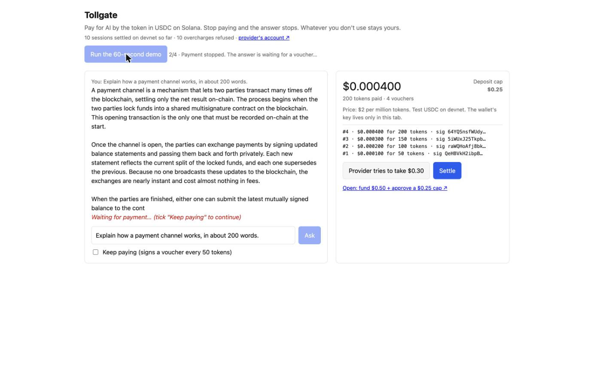
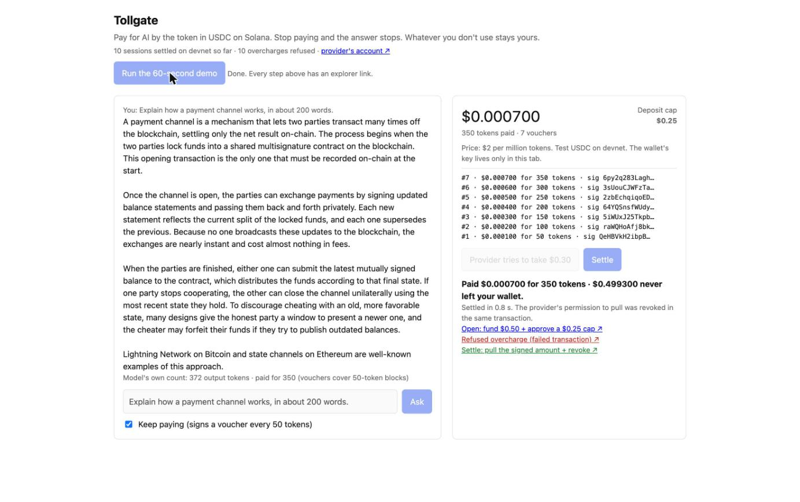

# Tollgate

Pay for AI by the token in USDC on Solana. Stop paying and the answer stops. Whatever you don't use never leaves your wallet.

Why Solana: paying a fraction of a cent per answer only works if settling costs less than the answer. On Solana the whole session settles in one transaction in about a second, for well under a cent, and a small on-chain program checks the signed voucher before any money moves.

**Live demo (devnet):** https://tollgate-production-6271.up.railway.app

| Stop paying: the answer waits | Settle: paid for 350 tokens, the rest never left the wallet |
|---|---|
|  |  |

## Try it in 30 seconds

Open the link and press **Run the 20-second demo**. It does the steps below on its own, with an explorer link for each one. To do it by hand:

1. Open the link. The page opens a session for you on Solana devnet: a fresh wallet gets $0.50 of test USDC and approves the Tollgate program to spend at most $0.25 of it.
2. Click **Ask**. The answer streams in while the tab signs a payment voucher every 50 tokens. The meter shows what you've paid so far.
3. Untick **Keep paying** while it's answering. The text stops with "Waiting for payment…". Tick it again and it carries on.
4. Click **Provider tries $0.30**. Your tab co-signs a $0.30 settle, and the Tollgate program still refuses it on-chain (error 1: above your signed voucher). You get the failed transaction's link.
5. Click **Settle**. One transaction checks your voucher on-chain, pays the provider exactly the signed amount and revokes the approval. The rest never left your wallet. You get explorer links for every step.

## How it works

```
browser tab                         gateway (Node)                      Solana devnet
-----------                         --------------                      -------------
makes its own wallet key   ───────► open: tab signs approve          ──► mint $0.50 + approve(Tollgate PDA, cap $0.25)
                                    stream AI answer, 50 tokens
◄── "pay up to N tokens"            at a time; waits for a voucher
signs voucher (amount, expiry) ───► checks the signature, releases
                                    the next block
                                    settle: tab signs revoke        ───► ed25519 verify(voucher)
                                                                         tollgate.settle(amount ≤ signed)
                                                                         revoke
```

- **Vouchers.** Each voucher is the 50-byte format the Solana Foundation's payment channels use (`0x56 0x01 · channel id · cumulative amount u64 · expiry i64`). The tab signs it with its own ed25519 key. The gateway won't stream past what the latest voucher covers.
- **Tollgate program** ([`program/src/lib.rs`](program/src/lib.rs), devnet [`58S2R4oQRDYts3qXK6PYwq9SwZg1oPnLGvYRdbxpFNWj`](https://explorer.solana.com/address/58S2R4oQRDYts3qXK6PYwq9SwZg1oPnLGvYRdbxpFNWj?cluster=devnet)). A 20 KB Pinocchio program with one instruction, `settle`. It reads the instructions sysvar, finds the Ed25519 check of a voucher signed by this payer for this payer's channel, and pays the provider at most the signed amount from the payer's token account, signing as its PDA. It refuses a settle the payer didn't sign (error 6, so nobody holding a voucher can replay it), a different payer, a different provider, a missing voucher, or an amount above the voucher (error 1). It does not check the voucher's expiry or keep a record of past payouts; the payer's signature on each settle and the revoke in the same transaction cover that for this demo.
- **On-chain cap.** At open, the tab's wallet approves the program's PDA (not the provider) as a token delegate for $0.25, so the total can never pass that either.
- **Settle.** One transaction: Ed25519 verify, `tollgate.settle`, and the tab's revoke.
- **Price.** $2 per million tokens (2 base units of 6-decimal USDC per token), paid in 50-token blocks.

## What is real and what isn't

- Every transaction is real and on Solana devnet. The USDC is a test token this project minted on devnet ("test USDC", 6 decimals). It is not Circle's USDC.
- Your browser tab makes its own wallet. Its key never leaves the tab, and it signs the on-chain approval, every voucher and the revoke at settle. The server only pays network fees and mints test USDC into the wallet, so you don't need a wallet extension. The key lives in page memory, so a reload starts a new wallet.
- The token count during streaming is an estimate (about 4 characters per token). The model's own count is shown under the answer when it ends.
- The gateway decides when to stop streaming; the chain decides how much can be paid. The settle amount is checked on-chain against the signed voucher.
- We first tried the Solana Foundation's payment-channels program on devnet and opened a channel on it ([open transaction](https://explorer.solana.com/tx/5NtC5ZKkgZqm4gMSPJFh9cGHACmUeKDLKiKuW2NJ1qaReur1KZ3EDREZktxcV1MGcz6KNx2AmGS39nsr3QSrzhgx?cluster=devnet)). Its payout step failed on devnet's treasury account check (`TreasuryAccountMismatch`), so we wrote the small settle program above instead, keeping the same voucher format.
- One provider (this project) and one model (Anthropic's Claude Haiku).

## Run it locally

```bash
cd app
npm install --legacy-peer-deps
mkdir -p keys && solana-keygen new -s --no-bip39-passphrase -o keys/operator.json && solana-keygen new -s --no-bip39-passphrase -o keys/payee.json
# fund keys/operator.json with devnet SOL, create a 6-decimal mint with it as mint authority, then:
echo "ANTHROPIC_API_KEY=..." > .env && echo "MINT=<your mint>" >> .env
npm start   # http://localhost:3000
```

Built for the MLH × Solana Hackathon, November 2026.
